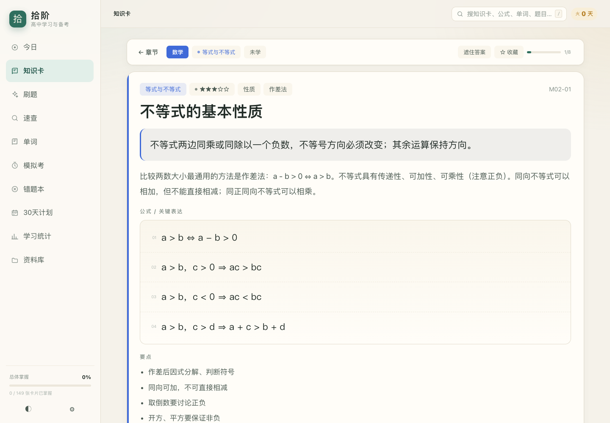
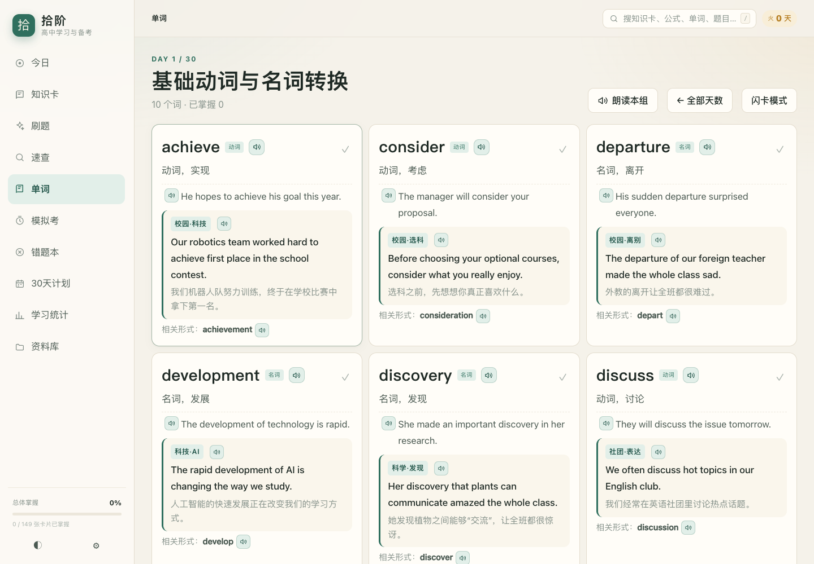

# 拾阶 · 高中学习与备考

> 把第一批高中资料拆成**每天能走完的一小步**：知识卡、速查、刷题、错题本、模拟考、30 天计划。所有英文单词、例句和情景短句都可以点击朗读。
> 无登录、无账号、无网络请求，打开就能学；电脑、iPad、安卓平板共用一套界面。

## 在线地址（已发布）

# **https://polaris-cyx.github.io/shijie-gaokao/**

平板/手机扫码直接打开：


> 部署在 GitHub Pages；不用登录、不用安装，平板 Safari/Chrome 打开后「添加到主屏幕」即可。






---

## 一、它是什么

这不是一个 PDF 阅读器，而是一条按「学 → 查 → 练 → 考 → 复盘」组织的学习路径。第一批 9 份资料已经被拆成：

| 内容 | 规模 |
|---|---|
| 知识卡 | **149 张**（数学 87 / 物理 16 / 化学 26 / 英语 20） |
| 题目 | **1593 道**（单选 741 / 多选 46 / 判断 211 / 填空 595） |
| 公式与结论 | **81 条** |
| 化学方程式 | **158 条** |
| 英语高频词 | **236 个**（按资料原 30 天主题分组） |
| 校园情景短句 | **236 条**（每个单词一条，配中文与朗读） |
| 解题方法卡 | **12 种**（基本不等式求最值） |

### 六个核心模块

| 模块 | 解决什么问题 |
|---|---|
| **今日** | 不知道今天该干什么。按复习到期、每日目标、30 天计划给出清单，倒计时 + 连续天数 + 经验等级。 |
| **知识卡** | 资料太厚。一屏一张卡：核心结论 → 公式 → 要点 → 例题 → 口诀 → 易错 → 来源页码。按「忘了 / 模糊 / 掌握」自动安排下次复习。 |
| **速查** | 考前只想看公式。公式、化学方程式、12 种最值方法，支持搜索与**遮罩自测**。 |
| **刷题** | 不知道自己会不会。按学科、章节、题型组卷，即做即判，解析带来源；答错自动进错题本。 |
| **模拟考** | 不知道能考多少分。综合卷/单科卷、限时、答题卡、交卷后给命中率与薄弱章节。 |
| **单词** | 英语词汇记不住。30 天分组，词性、释义、例句、**校园情景短句**、相关形式，支持逐词/逐句朗读、闪卡与「已掌握」。 |

另外还有 **错题本、30 天计划、学习统计（热力图/学科掌握度/章节正确率）、资料库（原始 PDF）**。

英文内容全部带朗读按钮：单词、例句、情景短句、英文题目选项、英文知识卡例句，点击即可用本机语音朗读；不需要联网，也不依赖第三方服务。

### 为「看得清」做的设计

- 全站**黑体**（PingFang SC / 微软雅黑 / 思源黑体），不使用细宋体；
- 正文基准 **18px**，卡片标题 29–36px，题目 19–22px，手机上也保持 17px 以上；
- 重点结论 21–22px，公式 19–21px，避免小朋友凑近屏幕；
- 深色模式、离线 PWA、键盘快捷键（`/` 搜索、`1/2/3` 评分、`←/→` 翻卡）；
- 所有英文单词和句子都有「小喇叭」按钮，使用电脑/平板/手机自带的语音引擎，断网也能读。

---

## 二、怎么打开

### 方式 1：直接双击（最快，零依赖）

双击项目根目录的 `index.html`，会自动跳到 `app/`。  
所有数据都在 `app/data.bundle.js` 里，**file:// 直接打开也能用**，不需要服务器。

> 部分浏览器对 file:// 的 localStorage 限制较严，学习记录可能不保存；长期用建议方式 2。

### 方式 2：Mac 一键启动（推荐，平板也能用）

双击 **`启动学习系统.command`**。终端会打印：

```
电脑：  http://localhost:4173/app/
平板：  http://192.168.x.x:4173/app/   （与电脑同一 Wi-Fi）
```

- 电脑浏览器打开「电脑」地址；
- iPad / 安卓平板打开「平板」地址（同一 Wi-Fi）；
- iPhone / iPad 可「分享 → 添加到主屏幕」，像 App 一样全屏使用；
- 停止：在终端按 `Ctrl+C`。

> 如果 macOS 提示「无法打开」，右键 → 打开，或在终端执行 `chmod +x 启动学习系统.command`。

### 方式 3：Windows

双击 **`启动学习系统.bat`**，会自动构建（首次）、启动本地服务器并打开浏览器。  
平板访问终端里打印的局域网地址即可。

### 方式 4：已经部署在网上（长期、免费）

线上地址：**https://polaris-cyx.github.io/shijie-gaokao/**

仓库：**https://github.com/polaris-cyx/shijie-gaokao**  
部署方式：GitHub Pages（静态文件全部在 `main` 分支根目录）。  
本地改完内容后，重新构建 `dist/` 并更新仓库即可；当前线上版本已包含全部 236 条情景短句、朗读和 9 份 PDF。

### 方式 5：单文件传到平板

`node tools/build-mobile.mjs` 会生成 **`dist/拾阶-单文件.html`**（CSS/JS/数据全部内联）。  
用 AirDrop / 微信发到平板，用浏览器打开即可。单文件不包含 PDF，资料库里的 PDF 链接需要原始 `materials/` 目录。

---

## 三、目录结构

```
高中学习备考系统/
├── index.html                 入口（跳到 app/）
├── app/                       前端应用（纯静态，无依赖）
│   ├── index.html             应用外壳
│   ├── app.css                样式（黑体、响应式、深浅色）
│   ├── app.js                 全部逻辑（约 1800 行）
│   ├── data.bundle.js         由 tools/build.mjs 生成，勿手改
│   ├── sw.js                  Service Worker（仅 https 注册）
│   ├── manifest.webmanifest   PWA 清单
│   └── icon-192/512.png       应用图标
├── data/                      ★ 唯一数据源
│   ├── meta.json              应用名、高考日期、每日目标、学科
│   ├── chapters.json          23 个章节（学科、名称、描述、页码、权重）
│   ├── sources.json           9 份原始资料索引
│   ├── plan.json              30 天计划
│   ├── formulas.json          81 条公式/结论
│   ├── chem_equations.json    158 条化学方程式
│   ├── vocab.json             236 个单词
│   ├── scenes.json            236 条校园情景短句
│   ├── methods.json           12 种最值方法
│   ├── kp/                    知识卡（按章节分文件）
│   └── questions/             题库（按来源/题型分文件）
├── materials/                 9 份原始 PDF（资料库直接打开）
├── tools/
│   ├── build.mjs              data/** → app/data.bundle.js（含结构校验）
│   ├── validate.mjs           内容质检（覆盖率/答案分布/重复题干）
│   ├── build-mobile.mjs       生成 dist/ 与单文件版
│   └── serve.mjs              本地服务器（支持 PDF Range 请求）
├── docs/                      预览图
├── 启动学习系统.command         Mac 一键启动
├── 启动学习系统.bat             Windows 一键启动
├── 更新网址内容.command         重新构建可部署产物
└── README.md
```

---

## 四、内容从哪来

| 资料 | 用途 |
|---|---|
| 《2026 年高中数学核心知识背记手册（背记版）》 | 数学 10 章知识卡与公式主干 |
| 《2026 年高中数学核心知识背记手册（默写版）》 | 遮罩/默写思路参考 |
| 《基本不等式求最值的 12 种方法汇总》 | 12 张方法卡 |
| 《基本不等式最值的 12 种方法（精简版）》 | 方法速览 |
| 《集合与不等式 · 答案与解析（合订版）》 | 集合与不等式题目的依据 |
| 《高中物理必修一 · 第一章 运动的描述》 | 物理 P01/P02 知识卡与题目 |
| 《高中化学方程式大全知识清单（2027 届）》 | 158 条方程式与化学知识卡 |
| 《高中英语核心高频词汇 30 天系统练习》 | 595 道填空题（逐题转换） |
| 《高中英语核心高频词汇 30 天答案解析》 | 填空题解析与单词释义 |

> 情景短句是在原资料词汇基础上**额外扩展**的校园/科技/运动/心理等主题句子，不是教材原文；每个单词一条，配中文翻译与朗读。

说明：

- 每张卡、每道题都带 `source.file` 与 `source.page`，在卡片底部/解析里可直接点回原 PDF 页码；
- 化学/数学部分为基于资料重新整理的学习卡，若与原文冲突，以原文为准；
- 资料仅在本机/本仓库内使用，不对外分发。

---

## 五、怎么改内容

### 1. 改数据

所有可编辑内容在 `data/`。字段规范见 **[`data/SCHEMA.md`](data/SCHEMA.md)**。  
最短路径：

```bash
# 改完任意 data/*.json 或 data/kp、data/questions 后
node tools/build.mjs       # 重新打包 + 结构校验
node tools/validate.mjs    # 内容质检
```

> 页面读取的是 `app/data.bundle.js`，**不重新 build 就看不到改动**。

### 2. 加一张知识卡

在 `data/kp/M03.json` 的 `items` 里加：

```json
{
  "id": "M03-14",
  "subject": "math",
  "chapter": "M03",
  "topic": "函数图象的对称性",
  "core": "……",
  "detail": "……",
  "formulas": ["f(a+x) = f(a-x) ⇔ 对称轴 x = a"],
  "bullets": ["……"],
  "examples": [{ "q": "……", "a": "……" }],
  "mnemonic": "……",
  "trap": "易错：……",
  "source": { "file": "高中数学核心知识背记手册（背记版）.pdf", "page": 26 },
  "star": 4,
  "tags": ["对称"]
}
```

然后 `node tools/build.mjs`。

### 3. 加一道题

在 `data/questions/Q_MG_math.json` 里加：

```json
{
  "id": "Q-MG-9001",
  "subject": "math",
  "chapter": "M03",
  "type": "single",
  "stem": "……（　）",
  "options": ["A 项", "B 项", "C 项", "D 项"],
  "answer": [1],
  "explain": "……",
  "source": { "file": "高中数学核心知识背记手册（背记版）.pdf", "page": 26 },
  "difficulty": 2,
  "tags": ["函数"]
}
```

- `type` 支持 `single` / `multi` / `judge` / `fill`；
- `judge` 的选项固定为 `["正确","错误"]`，`answer` 为 `[0]` 或 `[1]`；
- `fill` 用 `answerText: ["答案"]`，不需要 `options`；
- 单选 4 个选项；多选至少 2 个正确项。

### 4. 扩展情景短句

`data/scenes.json` 按单词关联：

```json
{
  "items": [
    {
      "id": "SC-0001",
      "word": "achieve",
      "en": "Our robotics team worked hard to achieve first place in the school contest.",
      "cn": "我们机器人队努力训练，终于在学校比赛中拿下第一名。",
      "tag": "校园·科技"
    }
  ]
}
```

`word` 必须与 `vocab.json` 中的 `word` 一致（大小写不敏感）。重新 `node tools/build.mjs` 后，单词卡会自动出现「情景」区块和朗读按钮。

### 5. 改每日目标 / 高考日期

- 默认值在 `data/meta.json`；
- 运行时可在「设置」里改，存在本机 localStorage。

### 6. 换配色 / 字号

- 颜色、字号集中在 `app/app.css` 顶部 `:root` 与「可读性」覆盖块；
- 学科颜色在 `data/meta.json` 的 `subjects[].color`。

---

## 六、数据与隐私

- 没有登录、没有服务器、没有埋点、没有网络请求；
- 学习进度、错题、笔记、单词掌握、模考记录全部存在浏览器 `localStorage`（键名 `shijie_gaokao_v1`）；
- 换设备不同步；可在「设置 → 导出学习记录」备份为 JSON，再在新设备导入；
- 清空浏览器站点数据会删除记录，请定期导出。

---

## 七、已知边界

- 物理第一批只有必修一第一章，后续章节可继续按 `data/kp` 格式补充；
- 填空题按「完全匹配」判分，拼写/词形错误会被判错；判错后可点「我写的是同义表达，算对」自纠；
- 数学公式使用轻量排版（分数、根号、上下标、化学箭头），不是完整 LaTeX；复杂公式建议写在例题文字里；
- 英文朗读使用浏览器自带的 `speechSynthesis`，不联网；如果设备没有安装英文语音，可能读不出或发音不理想，可在系统设置里安装英语语音；
- 本地 http 不注册 Service Worker（避免开发缓存），https 部署后才有离线缓存；
- 单文件版不包含 PDF，资料库里的 PDF 链接需要 `materials/` 目录。

---

## 八、发音说明

| 位置 | 可朗读内容 |
|---|---|
| 单词页 | 每个单词、原例句、校园情景短句；「朗读本组」一次读完整组单词 |
| 单词详情弹窗 | 单词、例句、情景短句 |
| 英文填空题 | 题干 +「朗读整题」；英文选项也有小喇叭 |
| 英文知识卡 | 例题、例句、英文选项 |

实现方式是调用设备本机的语音合成（macOS / Windows / iOS / Android 都自带），**不请求网络**。如果点击后没有声音，检查系统是否安装了英语语音，或换用 Chrome / Safari。

## 九、快捷键

| 键 | 作用 |
|---|---|
| `/` 或 `⌘K` | 全局搜索 |
| `1` / `2` / `3` | 当前卡片：忘了 / 模糊 / 掌握 |
| `←` / `→` | 上一张 / 下一张 |
| `空格` | 遮住 / 显示答案 |
| `T` | 切换深浅色 |
| `Esc` | 关闭弹层 |
| `?` | 帮助 |

---

## 十、版本管理与仓库状态

- 本地源仓库：`高中学习备考系统/`，分支 `main`，标签 `v1.1.0`
- 线上部署仓库：<https://github.com/polaris-cyx/shijie-gaokao>（只含 `dist/` 构建产物，历史与源仓库独立）
- `dist/` 被 `.gitignore` 忽略；它由 `node tools/build-mobile.mjs` 重新生成
- 源仓库当前**没有配置 GitHub remote**，本机 `.git` 是唯一完整源历史；线上仓库是发布产物，不是源仓库的 remote
- 每次改完内容的标准流程：

```bash
node tools/build.mjs
node tools/validate.mjs
node tools/build-mobile.mjs
git add -A && git commit -m "说明这次改了什么"
```

- 当前仓库检查：`git status` 干净、`git fsck` 通过、73 个受控文件、9 份 PDF、约 27 MB `.git`

## 十、开发

无 npm 依赖，只需要 Node.js ≥ 18。

```bash
node tools/build.mjs        # 构建数据
node tools/validate.mjs     # 质检
node tools/serve.mjs        # 本地预览，默认 4173
node tools/build-mobile.mjs # 生成 dist/
```

技术栈：原生 HTML / CSS / JavaScript，localStorage，Service Worker，PWA。  
没有框架、没有构建器、没有 CDN，断网也能用。

---

## 十一、下一步可以加什么

- [ ] 物理必修一后续章节（第二章 匀变速直线运动的研究、第三章 相互作用）
- [ ] 化学按「反应类型」再做一套推断题
- [ ] 英语 750 题里的短文语境填空补齐
- [ ] 作文素材 / 语文古诗文（当前第一批资料未包含）
- [ ] 错题按「知识点」聚类，而不是只按章节
- [ ] 学习计划自定义（当前是固定 30 天）

---

**拾阶**：一步一步走，台阶会自己长出来。
